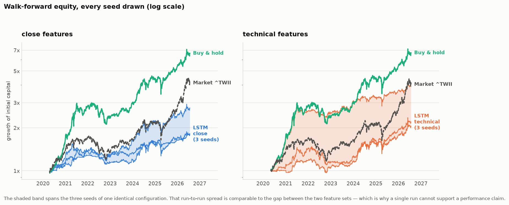
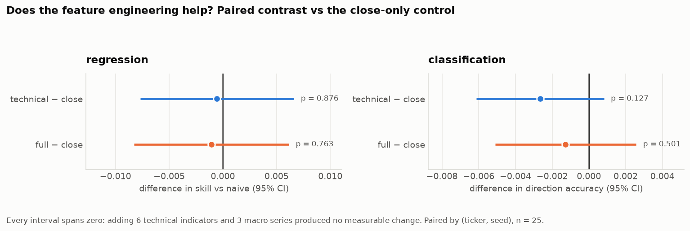
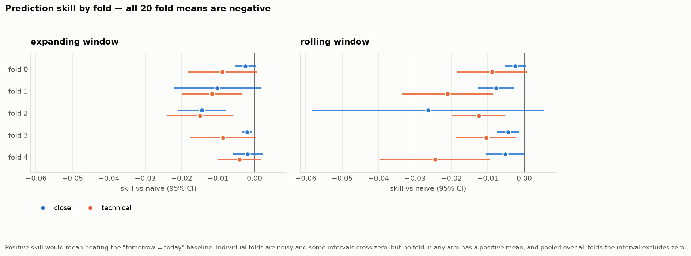
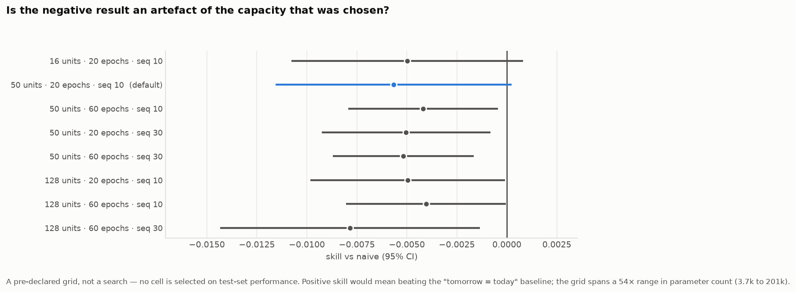

# 用 LSTM 預測台股

Jing-Zhi Chen · jameschen108@gmail.com · [English](README.md)

使用 LSTM 預測台股五檔權值股（2330 台積電、2317 鴻海、2603 長榮、2002 中鋼、
2891 中信金）的次日收盤價，再用模型的預測驅動一個 long/flat 的交易策略。

**結果是不行。** 模型沒有勝過「明天的價格 = 今天的價格」，策略也沒有勝過直接買進並
持有同樣這五檔。這份 README 說明我是怎麼量出來的。

做法沿用 Wang et al. (2025) [[1]](#參考文獻)——該論文比較 LSTM、GRU、CNN 於股價預測
的表現並以 FastAPI 提供服務；我取其中的 LSTM，套用到台股市場。

## 結果

| 問題 | 答案 |
|---|---|
| LSTM 有勝過「不變」基準嗎？ | 沒有。skill −0.0062（負值代表比基準差），95% CI [−0.0091, −0.0033] |
| 技術指標與宏觀因子有幫助嗎？ | 沒有可測量的差異（§2） |
| 交易策略有勝過買進持有嗎？ | 沒有。Sharpe 1.00 vs 1.56，總報酬 112% vs 565% |

在 1,524 個樣本外交易日上，方向準確率是 0.4971——等同擲銅板。

這些數字來自 §4 的 walk-forward 評估；那裡的方向準確率是迴歸模型預測漲跌的正負號。
全文的信賴區間都是對個別 run 做的 t 區間，把同一份資料上訓練的不同 seed 當成獨立
樣本，所以會比實際應有的略窄。



### 為什麼基準是「價格不變」

股價每天的變動很小，所以光是預測「明天 = 今天」，五檔股票平均的 R² 就有 0.9845
（單一 80/20 切分，測試期 2024–2026，5 個 seed）。我的模型是 R² = 0.9841——單看
很漂亮，直到你拿它跟它輸掉的那個基準比。

| 呈現方式 | 數字 | 讀者的印象 |
|---|---|---|
| 只報 R² | 0.9841 | 近乎完美 |
| 對照「不變」基準 | −0.0073 | 略遜於什麼都不做 |
| 方向準確率 vs 50% | 0.5184 | 略有優勢 |
| 方向準確率 vs 多數類別 | −0.0101 | 不如永遠猜比較常見的那個方向 |

兩列方向準確率來自在同一切分上另外訓練的漲跌分類器（§2），不是迴歸模型的正負號。
skill 是逐次 run 計算後再平均，而不是用跨股票平均的 RMSE 去算，因為那個平均（模型
7.5648、基準 7.5504）主要由 2330 的股價水準決定。

## 1. 模型看到的東西

yfinance 日收盤價，2014 年起。每個 10 日視窗以自身最後一根收盤價正規化，因此模型
預測的是**漲跌幅**而非價格水準：

```
ref     = 視窗中最後一根收盤價
X[j]    = prices[j] / ref - 1
y       = 明日收盤 / ref - 1
```

這件事很關鍵，因為那個顯而易見的替代方案——`MinMaxScaler`——不論怎麼擬合都會出問題。
2330 在訓練期價格約 70–630，到測試期末已漲到 2510。若 scaler 只在訓練列上擬合
（不洩漏的做法），測試輸入會落在 0.89 到 4.37 之間，遠超網路見過的 [0, 1]，於是飽和
並系統性低估。若改成套在整段序列上，所有值都會留在 [0, 1] 內——但那只是因為測試期的
最高最低價參與決定了邊界，也就是你原本想避開的那個洩漏。

只看 2330 一檔（與上面相同的 80/20 切分，seed 0–2），相同架構，只改變正規化方式。
在這檔股票上，模型與基準的 R² 都是 0.9968，所以最後一列的小幅正值是 2330 上的
近乎打平，並不推翻上面五檔平均的結論：

| 正規化方式 | RMSE | R² | 對照基準 |
|---|---|---|---|
| MinMax 只在訓練列擬合 | 310.96 | 0.6038 | −10.00 |
| MinMax 套在整段序列（有洩漏） | 134.98 | 0.9203 | −3.77 |
| 視窗相對報酬（本專案採用） | **28.15** | **0.9968** | **+0.0045** |

注意順序：洩漏測試期的價格範圍反而讓模型「看起來更好」，因為它把範圍問題掩蓋掉了。
兩者都遠差於基準的 RMSE 28.28。

特徵的計算都只用到過去的資料。有兩個我必須避開的陷阱：`scipy` 的
`gaussian_filter1d` 把核心對稱地放在每個點兩側，會混進未來價格（我改用單邊核），
以及美股日 t 的資料要到台股收盤之後才到，所以宏觀序列一律落後一天。

## 2. 加特徵有用嗎？

三組特徵集，其餘完全相同：只用收盤價（1 個輸入）、加 6 個技術指標（7 個輸入）、
再加 3 個宏觀序列（10 個輸入）。五檔股票 × 五個種子。

| 特徵集 | 對照基準的 skill | 95% CI | 方向準確率 |
|---|---|---|---|
| close | −0.0073 | [−0.0130, −0.0016] | 0.5184 |
| technical | −0.0079 | [−0.0134, −0.0023] | 0.5158 |
| full | −0.0084 | [−0.0139, −0.0028] | 0.5172 |

在相同股票、相同種子上，各組減去只用收盤價的對照組：

| 任務 | arm | 差異 | 95% CI | p |
|---|---|---|---|---|
| 回歸 | technical | −0.00055 | [−0.00770, +0.00661] | 0.876 |
| 回歸 | full | −0.00107 | [−0.00827, +0.00614] | 0.763 |
| 分類 | technical | −0.00266 | [−0.00613, +0.00082] | 0.127 |
| 分類 | full | −0.00127 | [−0.00511, +0.00257] | 0.501 |



每個區間都包含零：多加的特徵沒有帶來可測量的差異。

在接受這個結論之前，我先檢查了那個顯而易見的替代解釋。這些特徵通道的尺度差距極大——
MACD 柱狀圖的 σ ≈ 0.005、布林通道位置 σ ≈ 0.63，而模型真正要預測的價格報酬通道
σ ≈ 0.02。也許這些額外特徵不是不帶訊號，只是從來沒被公平對待。於是我把 150 次執行
全部以標準化後的通道重跑一次，統計量只取自訓練段：

| 任務 | arm | 對照 close 組 | 95% CI | p |
|---|---|---|---|---|
| 回歸 | technical | −0.00967 | [−0.01637, −0.00297] | 0.007 |
| 回歸 | full | −0.01034 | [−0.01720, −0.00347] | 0.005 |
| 分類 | technical | −0.00405 | [−0.00962, +0.00153] | 0.147 |
| 分類 | full | −0.00835 | [−0.01906, +0.00237] | 0.121 |

把通道放到對等的地位之後，多特徵組反而**更差**，不是更好。所以答案不是「特徵的尺度
沒調好」：在這份資料、這套評估之下，這些特定的指標沒有帶來幫助。

## 3. LSTM、GRU 還是 CNN？

三種我都跑了同一份研究。對照基準的 skill：

| | close | technical | full |
|---|---|---|---|
| LSTM | −0.0073 | −0.0079 | −0.0084 |
| GRU | −0.0049 | −0.0116 | −0.0135 |
| CNN | −0.0077 | −0.0582 | −0.0548 |

18 格全部為負。在相同股票與種子上兩兩對比，所有差異的信賴區間都包含零——在這份
資料上我分不出它們的高下，而且 LSTM 只在五檔中的一檔排第一。後續我仍沿用 LSTM，
是為了與我出發的那篇論文保持一致，不是因為它在這裡勝出。

## 4. 樣本外結果

單次 80/20 切分只測到市場的一段。所以我改成在五個時間點重新訓練，且只在模型沒看過
的資料上評分——2020 到 2026 年共 1,524 個交易日，涵蓋疫情反彈、2022 空頭、
2023–2026 多頭。

| fold | 測試區間 | skill | 方向準確率 |
|---|---|---|---|
| 0 | 2020-04 → 2021-07 | −0.0025 | 0.4919 |
| 1 | 2021-07 → 2022-10 | −0.0102 | 0.5250 |
| 2 | 2022-10 → 2024-01 | −0.0144 | 0.4660 |
| 3 | 2024-01 → 2025-04 | −0.0021 | 0.4932 |
| 4 | 2025-04 → 2026-07 | −0.0019 | 0.5095 |
| **全體** | **2020-04 → 2026-07** | **−0.0062** | **0.4971** |



沒有任何一種市場型態出現正的 skill。75 個「股票-fold-種子」單元中，15 個為正。

### 交易績效

Long/flat：模型預測會漲就持有，否則空手。成本用台股散戶費率——手續費 0.1425%
（雙邊）加上賣出時 0.3% 的證交稅。

| 策略 | 總報酬 | CAGR | 年化波動 | Sharpe | 最大回撤 |
|---|---|---|---|---|---|
| LSTM long/flat (close) | 111.61% | 12.87% | 12.92% | 1.00 | −19.19% |
| LSTM long/flat (technical) | 176.88% | 17.67% | 14.59% | 1.17 | −21.92% |
| 買進持有同 5 檔 | 565.17% | 36.80% | 21.56% | **1.56** | −29.22% |
| 大盤 ^TWII | 312.36% | 26.40% | 20.19% | 1.26 | −31.63% |

策略的波動與回撤都比較小，但風險調整後仍然落後。它只有 52.9% 的時間在市場裡，而在
長期上漲的市場中，空手的那段時間就是報酬的去處。

（^TWII 不含息，而五檔個股是含息還原的，所以大盤那一列略為低估。口徑一致的比較是
對上同 5 檔的買進持有。）

## 5. 兩件騙過我的事

**曝險看起來像實力。** 在 2024–2026 的單次切分上（單次 run，seed 42）：

| arm | 在市場的時間 | 總報酬 | Sharpe |
|---|---|---|---|
| close | 49.5% | 23.40% | 0.79 |
| technical | 80.1% | 80.04% | 1.44 |

看起來像是特徵工程的大勝。其實不是——§2 顯示兩者作為預測器在統計上無法區分。
多特徵模型只是比較常說「漲」，於是在上漲的市場裡待得比較久。在 walk-forward（§4）下
這個差距小得多——在市場的時間是 52.9% 對 57.9%——而 technical 在那裡較高的平均報酬，
大部分來自單一個 seed（見下）。

**跑一次什麼都證明不了。** 同一個模型、同一份資料，只改隨機種子：

| 特徵集 | seed 0 | seed 1 | seed 2 |
|---|---|---|---|
| close | 78.6% | 175.1% | 81.1% |
| technical | 119.1% | 105.4% | **306.1%** |

光是權重初始化就能讓總報酬從 105% 跑到 306%。這就是為什麼這份 README 裡其他每個
數字都是多個種子的平均。

我也確認了這不是模型沒訓練夠：8 種組態、參數量從 3.7k 到 201k、epoch 最多 60、
視窗最長 30 天。全部為負，沒有一種勝過基準。



## 6. 限制

* 只用日收盤價——沒有成交量、財報或新聞。
* Long/flat、每日再平衡：沒有部位大小控制、沒有停損、不做空。
* 成本含手續費與證交稅，但未計滑價；假設能以收盤價成交。
* 五檔股票、單一市場。這說的是這套做法**在這裡**不行，不是說股價預測不可能。
* 種子數：特徵研究 5 個、walk-forward 3 個，受運算資源限制。

## 7. 執行方式

Python 3.12.4，純 CPU。版本鎖在 `requirements.txt`，因為 TensorFlow 的小版本更動
會改變數字。

```bash
pip install -r requirements.txt
```

```bash
python -m pytest tests/ -q
```

51 個測試，不需網路（`yfinance` 以合成資料 monkeypatch），約 15 秒。它們覆蓋的是
最容易在無聲無息中破壞結果的那些地方：特徵不能看到未來、沒有任何東西跨過訓練／測試
切分被擬合、walk-forward 的 fold 不重疊、回測沒有前視偏誤且確實扣了成本。

```bash
python -m src.train --ticker 2330.TW --model-type LSTM
python -m src.predict --ticker 2330.TW --days 5
```

訓練單一模型並用它預測。

```bash
uvicorn src.api:app --port 8000
curl -X POST http://localhost:8000/predict -H "Content-Type: application/json" \
  -d '{"ticker":"2330.TW","model_type":"LSTM","prices":[2400,2410,2395,2420,2430,2415,2440,2450,2405,2350]}'
```

以 HTTP 提供預測服務。

```bash
python -m src.backtest --feature-set close      # 單次切分回測
python -m src.walkforward --seeds 0 1 2         # walk-forward（§4）
python -m src.experiment --epochs 20            # 特徵研究（§2）
python -m src.tuning                            # 容量檢查（§5）
python -m src.sensitivity --ticker 2330.TW      # 正規化檢查（§1）
python -m src.figures                           # 重建所有圖表
```

單次 20 epochs 的訓練約 5 秒；完整的特徵研究約 100 分鐘。所有圖表都是從 `reports/`
的 `.xlsx` 產物重建的；上面那些表格則是同一批實驗輸出的整理。

這些報表裡的東西比本 README 呈現的更多：逐標的的細分、滾動與擴張訓練視窗的對照、
逐 fold 的顯著性檢定，以及每一個平均數字背後的所有單次執行。

```bash
docker build -t stockai . && docker run -p 8000:8000 stockai
```

## 專案結構

```
src/
├── config.py       # 所有參數集中於此
├── data.py         # 下載與切窗
├── scaling.py      # 視窗相對正規化
├── features.py     # 技術指標與宏觀因子
├── model.py        # LSTM / GRU / CNN
├── train.py        # 訓練單一模型
├── predict.py      # 載入模型並預測
├── api.py          # FastAPI 服務
├── backtest.py     # 訊號 → 部位 → 成本 → 績效
├── walkforward.py  # 重訓並前滾的評估
├── experiment.py   # 特徵研究
├── tuning.py       # 容量掃描
├── sensitivity.py  # 正規化方式比較
├── metrics.py      # 指標與基準
└── figures.py      # 從 reports/ 重建圖表

tests/    離線測試套件
models/   訓練後的權重與對應的前處理規格
reports/  結果（.xlsx）與圖表
```

## 參考文獻

1. <a id="參考文獻"></a>Wang, H., Rajakumar, V. S., Golec, M., Gill, S. S., and Uhlig, S.
   (2025). StockAICloud: AI-based sustainable and scalable stock price prediction
   framework using serverless cloud computing. *The Journal of Supercomputing*, 81(4), 527.
   https://doi.org/10.1007/s11227-025-06984-7

## 授權

MIT，見 [LICENSE](LICENSE)。
